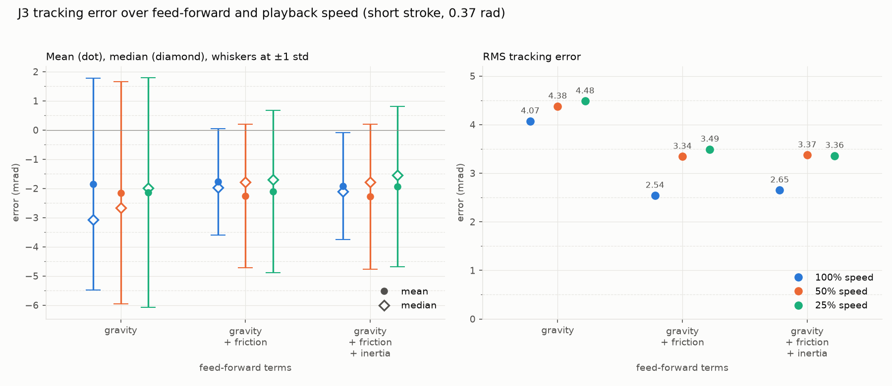
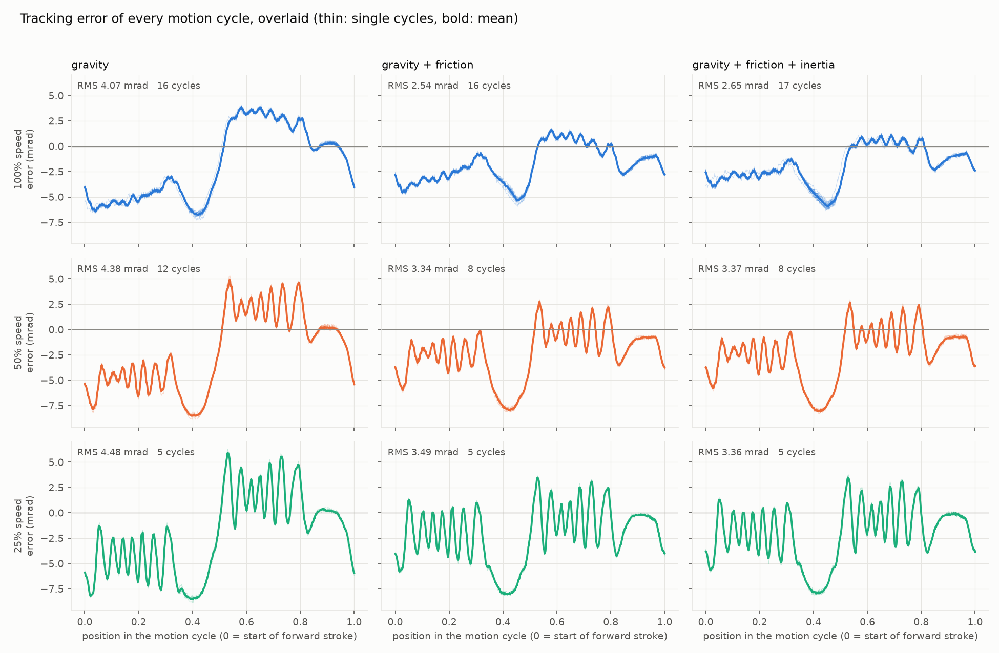
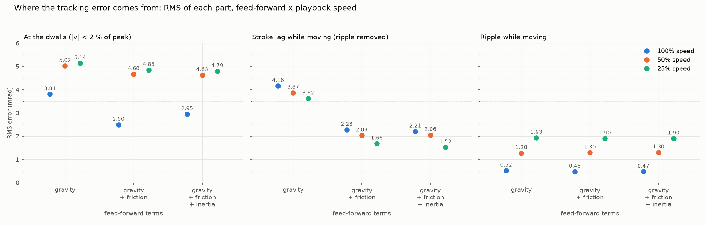
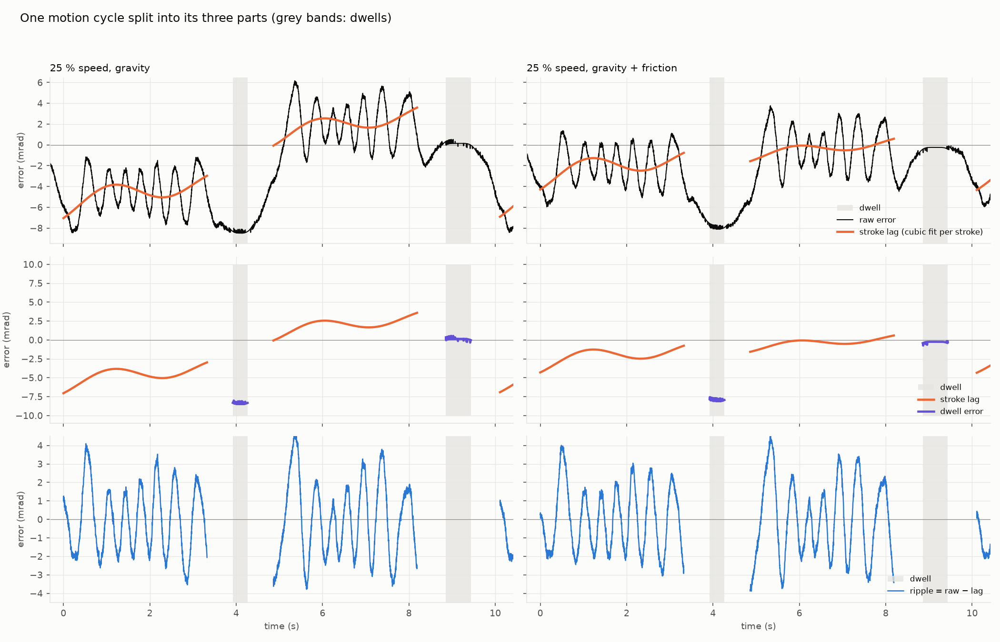
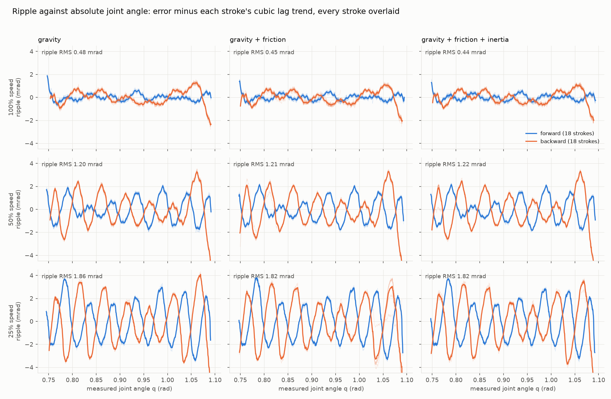
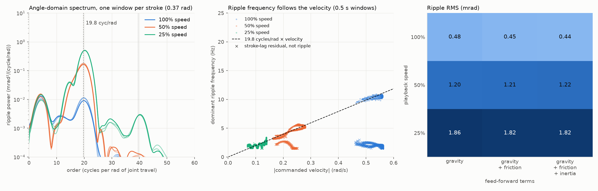
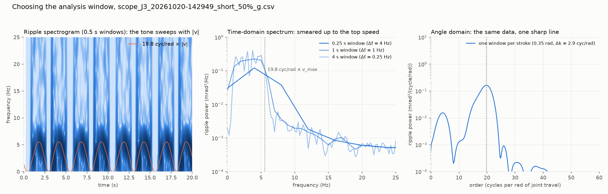

# Tracking error and vibration of J3 over feed-forward and playback speed

**Why.** Playback on the arm shows a tracking error that wobbles. The pendant can switch
three feed-forward terms (gravity, Coulomb friction, inverse dynamics) and the program
can be played at a fraction of its speed, so the question was which of these change the
error, by how much, and what the wobble is.

**How.** Scope recordings of joint J3 were taken on 2026-10-19 and 2026-10-20 while a
two-point program swung the joint back and forth, one recording per combination of
playback speed and feed-forward terms. `analysis/scope_analysis.py` reads them from
`data/`, decodes the conditions from the file names, and writes the figures and a
summary table to `analysis/figures/`:

```bash
uv run --with scipy --with matplotlib python analysis/scope_analysis.py
```

`data/` is not under version control; the figures and `summary.csv` are.

## The recordings

File names are snake case: `short` is the short stroke, `100%` / `50%` / `25%` the
playback speed, and the feed-forward terms are spelled out (`grav`, `fric`, `iner`) or
abbreviated (`g`, `gf`, `gfi`). The rest is the date and time.

| set | stroke | speeds | feed-forward | files |
|---|---|---|---|---|
| short (2026-10-20) | 0.37 rad, 0.737 to 1.107 rad | 100, 50, 25 % | g, gf, gfi | 9, the full 3 × 3 grid |
| medium (2026-10-19) | 1.57 rad | 100, 50, 25 % | gravity only (default) | 3 |
| long (2026-10-19) | 1.26 rad | 100, 50 % | gravity only (default) | 2 |

Every recording is one run at about 480 samples per second, 40 to 70 s long, with a
short dwell at each end of the stroke. The columns are time, commanded and measured
angle, their difference (`err_rad` = measured − commanded), the commanded and measured
torque, and from 2026-10-20 on the three feed-forward torques separately. The 2026-10-19
files lack the feed-forward columns and use other strokes, so they are not comparable
with the grid; they are in the summary table only.

Only the short-stroke grid is analysed below. Each cell is a single recording, so
differences of a tenth of a millirad between cells are within run-to-run drift and
should not be read as effects.

## Figures

### Tracking error over feed-forward and speed



Feed-forward terms on the x axis, one colour per playback speed. Left: the signed error
per recording, the dot at the mean, the hollow diamond at the median, whiskers at ±1
standard deviation. Right: the RMS. Mean and standard deviation were chosen for the
left panel because together they decompose the RMS (bias² + spread² = RMS²). The median
is drawn as well, as the "error most of the time": the distribution is bimodal (the
joint rests at two different offsets at the two dwells), so the median alone can jump
between the two lobes depending on how the cycles happened to fall, which is why it is
not the primary marker.

### Every motion cycle overlaid



One panel per condition, every cycle drawn thin and the mean cycle bold, against the
normalised position in the motion cycle (0 = start of the forward stroke). The cycles
repeat almost exactly: the error is deterministic, not noise.

### Where the error comes from



The error is split into three parts and the RMS of each shown per condition. *Dwell*:
samples where the commanded speed is below 2 % of its peak. *Stroke lag*: while moving,
the error minus the ripple, that is the slow lag that builds along each stroke. *Ripple*:
what remains while moving after a cubic trend per stroke is removed.



The same split on one 25 % cycle, gravity only beside gravity + friction: the raw error
with the cubic lag drawn over it, then the lag and the dwell error alone, then the
ripple. (Figure contributed by a side session of the same analysis.)

### The ripple against joint angle



The ripple of every stroke plotted against the *absolute* measured joint angle, forward
strokes in blue and backward in orange, mean pattern bold. The pattern is the same stroke
after stroke (the mean explains 86 to 100 % of the ripple variance): it is a function of
where the joint is. Forward and backward are phase-shifted, as a position-locked torque
disturbance seen through the loop's delay would be.

### The ripple spectrum



*Left, angle-domain spectrum.* Each stroke is resampled at even steps of joint angle
instead of time, the cubic lag removed, and a Hann-windowed spectrum taken over the
whole stroke and averaged over strokes. The x axis is in **cycles per rad**: how many
times the ripple oscillates per radian of joint travel (one cycle per rad is one wobble
per radian; 20 cycles per rad is one wobble every 0.05 rad, about 3°, or about 125 per
revolution). Every condition peaks at the dashed line, 19.8 cycles per rad, at every
speed; the dotted line is its second harmonic, visible only at 25 %. The peak height
falls about a hundredfold from 25 % to 100 % speed. The hump below 10 cycles per rad is
what is left of the stroke lag after the trend removal, not ripple.

*Middle, ripple frequency against velocity.* Back in the time domain, the dominant
frequency of each 0.5 s window against the commanded speed in that window. The dots fall
on the dashed line, 19.8 cycles per rad × velocity. Windows whose strongest line sits
below 65 % of that prediction are drawn as crosses: they are dominated by the remaining
stroke lag, not by the ripple.

*Right, ripple RMS* per condition, in millirad.

### Choosing the analysis window



The 50 % gravity-only recording. Left: a spectrogram of the ripple with 19.8 × |v| drawn
over it; the tone sweeps with the speed within every stroke. Middle: time-domain spectra
with 0.25, 1 and 4 s windows; a short window gives coarse resolution and a long one
smears the tone from 0 Hz to 19.8 × v_max, so no window length works. Right: the same
data in the angle domain, one window per stroke, where the ripple is a single sharp line.

## Findings (2026-10-22)

**Tracking error, short stroke, RMS in mrad** (from `summary.csv`):

| speed | gravity | gravity + friction | gravity + friction + inertia |
|---|---|---|---|
| 100 % | 4.07 | 2.54 | 2.65 |
| 50 % | 4.38 | 3.34 | 3.37 |
| 25 % | 4.48 | 3.49 | 3.36 |

**Its three parts, RMS in mrad** (dwell / stroke lag / ripple):

| speed | gravity | gravity + friction | gravity + friction + inertia |
|---|---|---|---|
| 100 % | 3.81 / 4.16 / 0.52 | 2.50 / 2.28 / 0.48 | 2.95 / 2.21 / 0.47 |
| 50 % | 5.02 / 3.87 / 1.28 | 4.68 / 2.03 / 1.30 | 4.63 / 2.06 / 1.30 |
| 25 % | 5.14 / 3.62 / 1.93 | 4.85 / 1.68 / 1.90 | 4.79 / 1.52 / 1.90 |

1. **Friction feed-forward is the term that matters.** It roughly halves the stroke lag
   at every speed (about 4 mrad to about 2 mrad) and cuts the overall RMS by 1.0 to
   1.5 mrad. The dwell error improves only at 100 % speed.
2. **The inertia term does nothing measurable.** The recorded inertia torque peaks at
   0.11 N·m at 100 % speed, 0.028 N·m at 50 % and 0.007 N·m at 25 %: the same path played
   slower has 1/16 of the acceleration at a quarter speed, so the term is smallest, not
   largest, at low speed. The 0.13 mrad advantage of `gfi` over `gf` at 25 % is a uniform
   +0.09 mrad offset over the whole cycle, dwells included, where the inertia torque is
   zero: run-to-run drift, not inertia. At 100 % the term does move the error during the
   strokes (±0.5 to 0.7 mrad), partly helping and partly hurting, net slightly worse,
   which suggests the inertia model is off (the armature is still 0 in the config).
3. **Gravity cannot be ranked from these runs.** Gravity feed-forward was on in every
   recording and is by far the largest torque, 5.8 to 6.0 N·m against 0.37 N·m of
   friction; without it the 160 N·m/rad position gain would leave about 37 mrad of
   steady error. The defensible statement is: with gravity compensated, friction is the
   dominant modelled effect and inertia is negligible.
4. **The dwell error is stiction the friction term cannot reach.** At the upper dwell,
   reached moving upward against gravity, the joint stalls about 8 mrad short and the
   feedback has to add about 1.2 N·m beyond the gravity model; at the lower dwell,
   reached moving downward, the extra is zero. A gravity-model error would not flip
   between two poses 0.37 rad apart (the model torque changes by 0.15 N·m over the
   stroke); stiction does. 1.2 N·m is three times the configured Coulomb value, and the
   friction feed-forward vanishes with the commanded velocity exactly when break-away is
   needed, so the term is under-sized for the dwell and absent at the moment it matters.
5. **The vibration is a position-locked ripple, not a resonance.** It sits at 19.8
   cycles per rad of joint travel (about 125 per revolution, period about 3°) at every
   speed and in every feed-forward condition. Its frequency in Hz is 19.8 × joint
   velocity: 2.8 Hz at 25 %, 5.5 Hz at 50 %, 11 Hz at 100 % on the short stroke. No
   fixed-frequency ringing shows up in any recording.
6. **The ripple grows as the speed drops** (0.5, 1.2, 1.8 mrad RMS at 100, 50, 25 %)
   and no feed-forward term touches it. At low speed its frequency is near the few-hertz
   stiffness of the position loop, where it is not rejected; at full speed it is above
   the loop bandwidth and the arm's inertia filters it. At 25 % it is 1.8 of the 3.4 mrad
   RMS, the largest single component.
7. **Slower is not better.** With friction compensation the RMS rises from 2.5 mrad at
   100 % to 3.4 mrad at 25 %, because of the ripple.
8. **Likely source of the ripple.** Motor torque ripple or gear mesh at about 125 cycles
   per output revolution; the vendor's pole-pair count times the gear ratio would say
   which. It is a candidate for a position-indexed compensation table rather than for
   any of the trajectory feed-forward terms.

## Method notes

* **Strokes** are the stretches where the commanded speed exceeds 30 % of its peak;
  **dwells** where it is below 2 %.
* **Ripple extraction**: per stroke, subtract a cubic fit of the error against
  commanded angle (the lag), keep the remainder. The cubic removes the stroke-scale
  shape without touching a 20 cycle-per-rad oscillation (about 7 cycles per short
  stroke).
* **Angle-domain spectrum**: resample the ripple at 0.5 mrad steps of commanded angle,
  one Hann window per stroke, zero-padded, averaged over strokes. With the 0.37 rad
  stroke the resolution is 2.9 cycles per rad, enough to separate the 20 and 40
  cycle-per-rad lines; the 1.3 to 1.6 rad strokes of 2026-10-19 resolve it more
  sharply. Because the ripple frequency follows the velocity, a time-domain window of
  any length either lacks resolution or smears the tone; the angle domain is the right
  place to measure it.
* **Statistics** are over whole recordings, dwells included, except where the
  breakdown says otherwise.

## Suggested next measurements

* Repeat the 25 % `gf` / `gfi` pair back to back, alternating the setting, to confirm
  the 0.1 mrad offset follows the clock rather than the setting.
* Test the inertia term where it is large enough to matter: 100 % speed with a non-zero
  armature and a swept `inertia_scale`.
* Raise `friction.coulomb` toward the 1.2 N·m the upper dwell asks for, or add a
  break-away term that does not vanish with the commanded velocity, and watch the dwell
  error.
* Record one run with gravity feed-forward switched off at hold gains, if the arm can
  be held safely, to put the gravity term on the same footing as the others.
* Confirm the ripple source from the motor's pole pairs and the gear ratio, then try a
  position-indexed torque table on J3.
